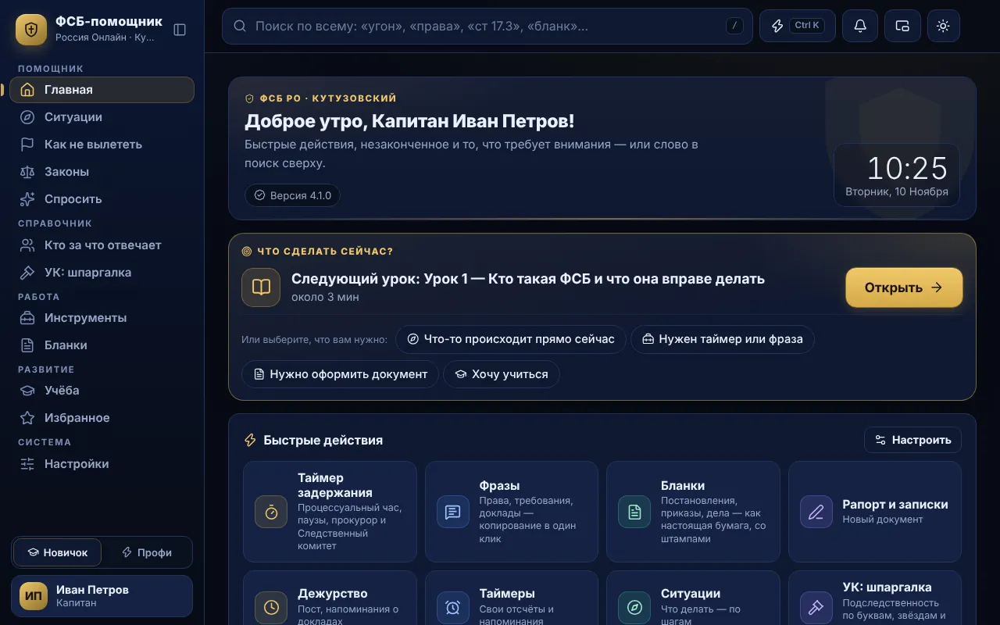
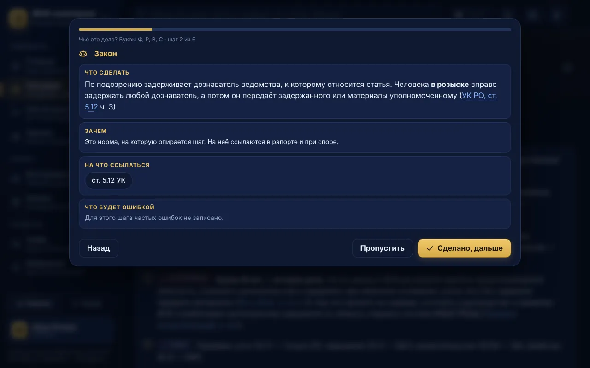
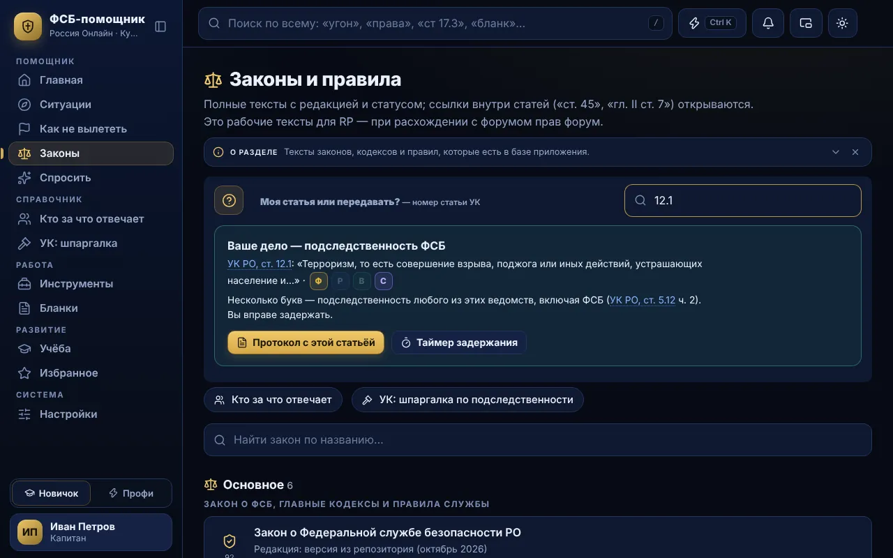
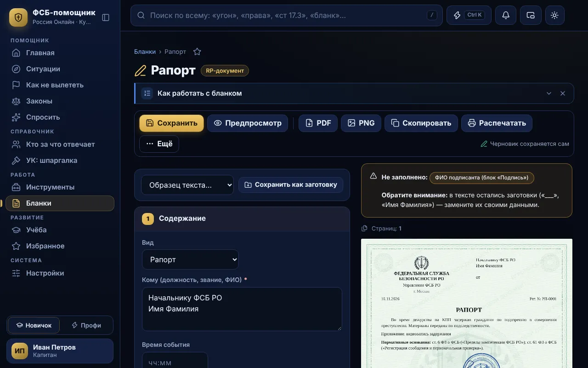
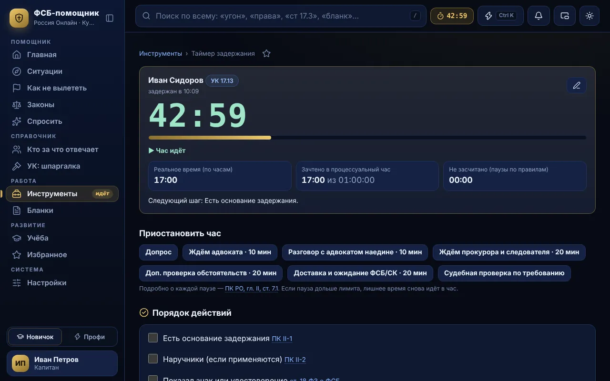

# ФСБ-помощник · Кутузовский

**Неофициальный игровой RP-помощник. Не является официальной программой или юридическим источником.**

Помощник сотрудника ФСБ для сервера «Кутузовский» игры «Россия Онлайн»: ситуации по шагам, законы с поиском, бланки, таймеры, панель поверх игры (Insert), учёба с экзаменом. Программа для Windows; вход по логину и ключу от владельца проекта.

| | |
|---|---|
|  |  |
|  |  |

## Почему именно эта программа

- Поиск по 1353 статьям 19 законов и правил. Номер — как привыкли («ук 17.13», «пго 9.9»), слова — как говорите («угнал», «тачка»). Забыли раскладку или ошиблись буквой — поиск поправит сам.
- 12 бланков с гербом, подписью и печатью. Заполнили поля — получили PDF, картинку для форума или текст.
- Таймер задержания показывает процессуальное время, паузы и следующий шаг. Завершили — задержание само попало в журнал смены.
- Журнал и счётчики смены: кто, по каким статьям, чем кончилось. Сводка для доклада копируется одной кнопкой.
- Введите номер статьи — программа подскажет, ваша ли это ситуация или её надо передать, и почему.
- Панель поверх игры по клавише Insert: фразы, подсказки и таймеры прямо в игре.
- Нажали «Получить» в окне входа — ключ придёт туда же сам, как только владелец его выдаст.
- 27 ситуаций по шагам, 11 уроков и 50 вопросов с экзаменом. Режим «Новичок» объясняет каждый шаг.

## Что нового в 3.6.1

- Ключ по заявке приходит обычно за 10–30 секунд (пока программа открыта) и работает сразу — даже если GitHub ещё обновляет сайт: к ключу прикладывается пропуск, подписанный владельцем.
- Панель поверх игры снова нажимается: открываясь, она забирает мышь у игры, а после закрытия (Insert, Esc или копирование) управление возвращается игре. В панели появился поиск.
- Счётчики смены: цифра видна сразу после «+», без переключения окна.
- Надёжнее хранение: аккаунт, настройки и заявка пишутся «целиком или никак» и держат резервную копию — внезапное выключение компьютера или полный диск больше не теряют вход и ключ.
- Экзамен: 30 вопросов за 25 минут, сдан от 95 %, новые сложные вопросы. Во время экзамена справочник закрыт: уход к законам или в другой раздел аннулирует попытку, а следующая начнётся с другими вопросами.
- Ключ — прямо из программы: внизу окна входа «Получить», игровой ник Имя_Фамилия — и ключ придёт в это же окно. Внизу окна входа — поддержка: ВКонтакте и Discord владельца.
- Пароль меняется без ключа: «Сменить пароль» на экране входа. «Забыли пароль?» — логин и тот же ключ: аккаунт и данные сохраняются.
- Вход, ключ и привязка к сайту сохраняются при обновлении: после установки новой версии программа входит сама и сообщает, что обновилась.
- Умный поиск: номер статьи в любом виде («ук 17.13», «ст. 17.13 УК РО», «17,13», «пго 9.9»), исправление раскладки и опечаток. Журнал и счётчики смены — сводка для доклада одной кнопкой.

## Скачать

- Сайт: https://fsb-helper-ru.github.io/fsb-helper-kutuzovsky/
- Скачать для Windows: [FSB-Helper-Setup.exe](https://github.com/fsb-helper-ru/fsb-helper-kutuzovsky/releases/latest/download/FSB-Helper-Setup.exe)

Файлы не имеют коммерческой цифровой подписи; сверяйте SHA-256 (файл [SHA256SUMS.txt](SHA256SUMS.txt)) и скачивайте только с официальной страницы проекта.

Файлы сайта: `index.html` — страница, `version.json` — подписанный файл обновлений, `app-3.6.1.html` — обновление программы, `lic.json` — подписанный список доступа (только хэши, без логинов и ключей), `pulse.json` — сигнал об изменениях, `users.enc.json` — зашифрованная копия списка для Центра управления, `inbox.json` — зашифрованные ответы на заявки на ключ (прочитать может только компьютер, отправивший заявку).
