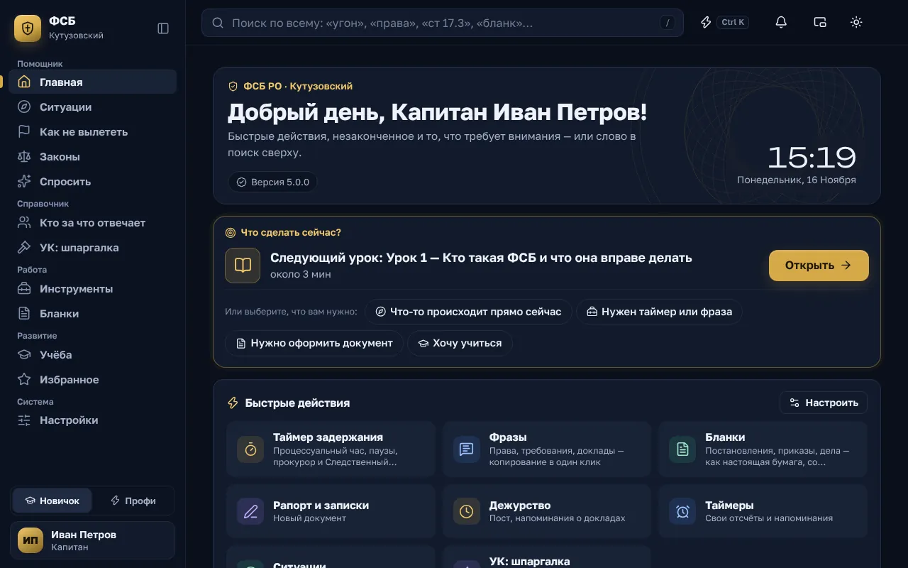
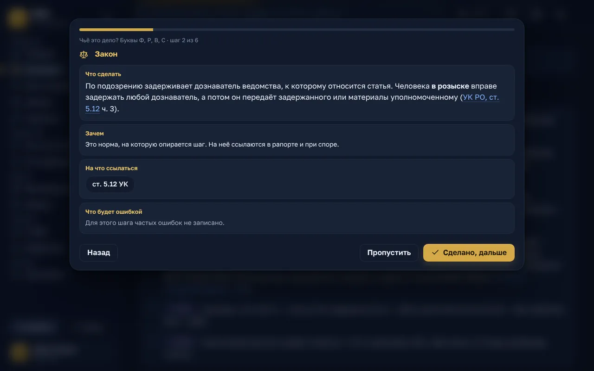
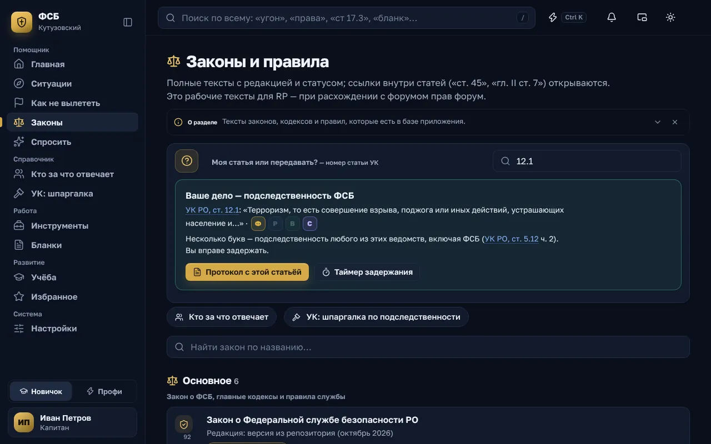
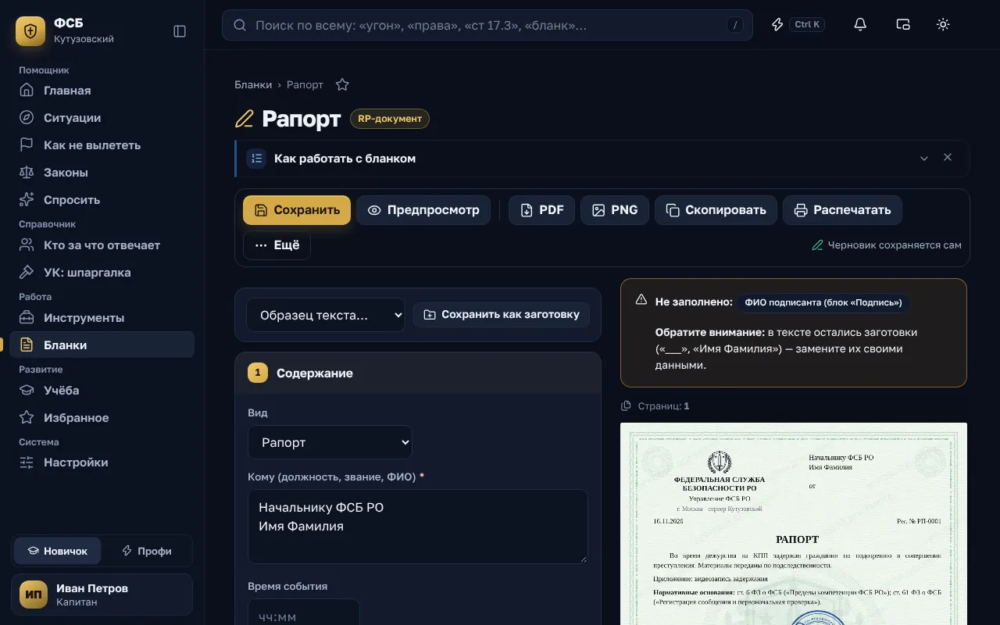
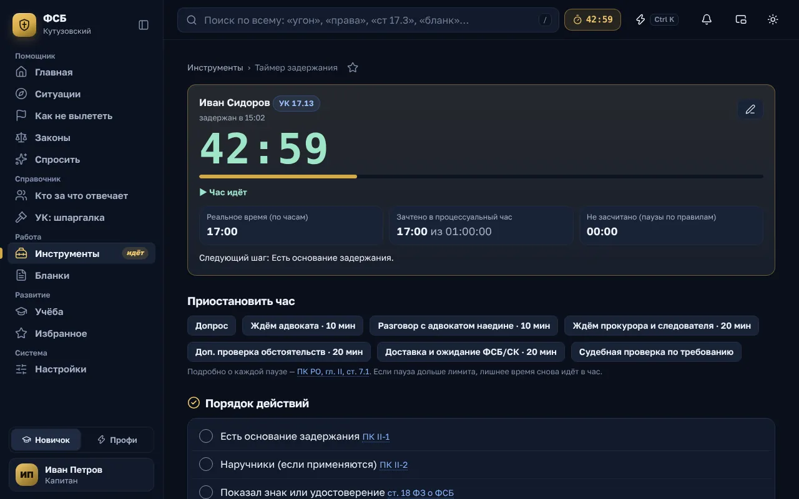

# Регламент — помощник госструктур · Россия Онлайн

**Неофициальный игровой RP-помощник. Не является официальной программой или юридическим источником.**

Помощник для игроков госструктур «Россия Онлайн»: 12 служб на трёх серверах — Кутузовский, Арбат, Тверской (какой модуль открыть, решает ключ). Ситуации по шагам, законы с умным поиском, бланки с печатями, таймеры и журнал смены, панель поверх игры (Insert), запись экрана и повтор, помощник «Спросить», учёба с экзаменом. Программа для Windows; вход по логину и ключу от владельца проекта.

| | |
|---|---|
|  |  |
|  |  |

## Почему именно эта программа

- Поиск по 8864 статьям 185 законов и правил трёх серверов — у каждой службы законы своего сервера. Номер — как привыкли («ук 17.13», «пго 9.9»), слова — как говорите («угнал», «тачка»). Забыли раскладку или ошиблись буквой — поиск поправит сам.
- У каждой службы от 11 до 25 видов документов с эмблемой, подписью и печатью своей службы. Заполнили поля — получили PDF, картинку для форума или текст.
- Таймер задержания показывает процессуальное время, паузы и следующий шаг. Завершили — задержание само попало в журнал смены.
- Журнал и счётчики смены: кто, по каким статьям, чем кончилось. Сводка для доклада копируется одной кнопкой.
- Введите номер статьи — программа подскажет, ваша ли это ситуация или её надо передать, и почему.
- Панель поверх игры по клавише Insert: фразы, подсказки и таймеры прямо в игре.
- Нажали «Получить» в окне входа — ключ придёт туда же сам, как только владелец его выдаст.
- У каждой службы не меньше 20 ситуаций по шагам, уроки и не меньше 15 своих вопросов с экзаменом. Режим «Новичок» объясняет каждый шаг.

## Что нового в 5.0.0

- Документы своей службы и своего сервера: у каждой из 12 служб своя эмблема и печать, на бумаге — свой сервер; у служб, которые не задерживают, нет протокола задержания.
- Библиотека документов: у каждой службы от 11 до 25 видов бланков по формам своего сервера — выпадающие списки подразделений и званий, нумерация, предпросмотр, PDF, картинка или текст для форума.
- Ситуации и экзамены на всех 36 страницах: у каждой не меньше 20 полных ситуаций (условия, шаги, статьи, можно и нельзя, примеры фраз) и не меньше 15 своих вопросов службы; экзамен — по правилам своей страницы.
- Командный центр (Инструменты → Командный центр): наборы слотов под игровые ситуации, клавиши с проверкой, макросы-отыгровки, таймеры и журналы с выгрузкой в файл, шпаргалка слотов на HUD поверх игры. Программа ничего не нажимает за игрока: клавиши только открывают панель и копируют текст.
- Защита: страницы служб на сайте и в установщике зашифрованы и открываются только с действующим ключом. Если вы входили в прежнюю версию, один раз введите ключ заново — логин, пароль и данные сохраняются.
- Новый вид: встроенный шрифт, светлая и тёмная темы, у каждой службы свой цвет и значок, новый экран входа, аккуратный HUD, плавные переходы между разделами.
- С версий 3.4–4.2.1 — через новый установщик: программа сама предложит его скачать; аккаунт и данные сохраняются.

## Скачать

- Сайт: https://fsb-helper-ru.github.io/fsb-helper-kutuzovsky/
- Скачать для Windows: [FSB-Helper-Setup.exe](https://github.com/fsb-helper-ru/fsb-helper-kutuzovsky/releases/latest/download/FSB-Helper-Setup.exe)

Файлы не имеют коммерческой цифровой подписи; сверяйте SHA-256 (файл [SHA256SUMS.txt](SHA256SUMS.txt)) и скачивайте только с официальной страницы проекта.

Файлы сайта: `index.html` — главная (`guides.html`, `faq.html`, `security.html`, `changelog.html` — страницы, `site.css` — стиль), `version.json` — подписанный файл обновлений, `app-5.0.0.fsbm` и `app_army-5.0.0.fsbm` — обновление программы (страницы модулей ФСБ и «Армия»), `lic.json` — подписанный список доступа (только хэши, без логинов и ключей), `pulse.json` — сигнал об изменениях, `users.enc.json` — зашифрованная копия списка для Центра управления, `inbox.json` — зашифрованные ответы на заявки на ключ (прочитать может только компьютер, отправивший заявку).
